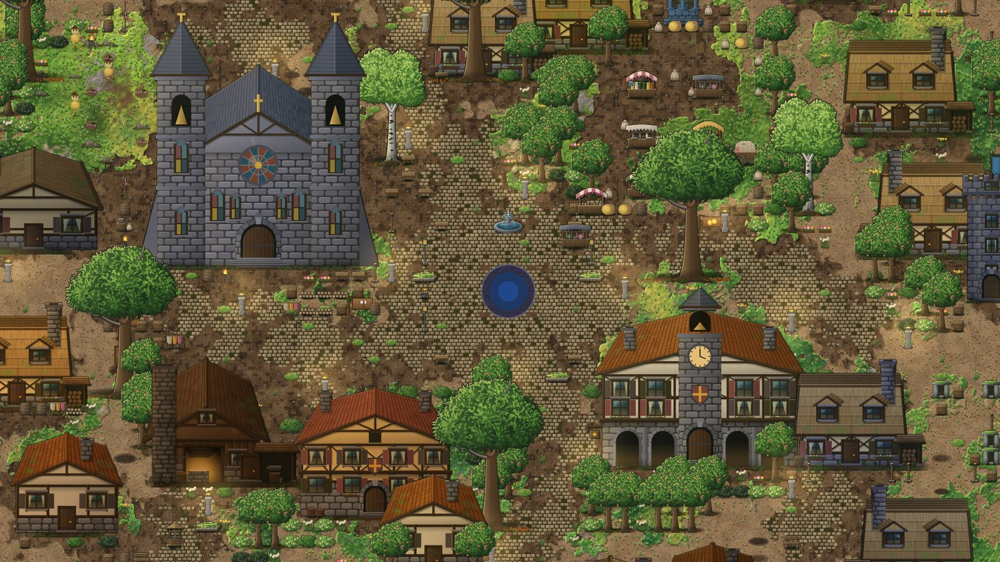

# Jiří Hyan

I build software end to end — games, desktop apps and the tooling around them — usually alone,
from the data model to the last pixel. I like problems where the result has to be generated rather
than drawn: procedural worlds, simulations, and test harnesses that photograph an app nobody is
looking at.

[LinkedIn](https://www.linkedin.com/in/ji%C5%99%C3%AD-hyan-3a7736260/) · Czech Republic

 

## Ashrim

**A single-player MMO that behaves like a live server.** You are the only real player, but simulated
bot players level up, fight and die around you, three realms wage a cold war, and the front line
against the Darkness moves on its own — whether you are there or not.

- **Every pixel is code.** Terrain, buildings, characters and UI come from canvas-2D generators —
  no bitmaps, no AI-generated art. A 3072 × 3072-tile world, from the last city to the scorched edge.
- **The world simulation runs in Rust, compiled to WebAssembly**, next to a Phaser 3 + TypeScript
  game, shipped as a Tauri desktop app.
- **1,900+ automated tests** and headless screenshot harnesses that render the world, cities and
  characters without opening a window — visual changes are reviewed as before/after images.

Phaser 3 · TypeScript · Rust / WASM · Tauri 2 · private repository

 

## WorkSpace

<table>
  <tr>
    <td width="50%"></td>
    <td width="50%"></td>
  </tr>
</table>

**A 3D office where AI coding agents come to work.** Every Claude Code session becomes a coworker in a
low-poly campus: they hold a morning stand-up grounded in real git and test results, take tasks from
you, and walk over to hand in their work for review.

- The raw agent event stream never reaches the UI — the Electron main process reduces it to typed
  state first, so the React Three Fiber scene renders only from that state and can be swapped freely.
- A concurrency governor shares one subscription's rate limit across all agents, and every risky
  tool call waits for a human to approve it.

Electron · React 19 · Three.js / React Three Fiber · TypeScript · SQLite · Claude Agent SDK · private repository

 

## Ledge &nbsp;open source

**An always-on drawer at the top edge of the Windows screen** — projects and dev servers, running
coding sessions, notes and quick actions, one mouse move away. It never steals focus and goes quiet
while a fullscreen game is running.

Rust · Tauri 2 · SolidJS · [source](https://github.com/jiri-hyan/ledge-app) · [download](https://github.com/jiri-hyan/ledge-app/releases/latest)

 

## Also built

| | |
| --- | --- |
| **War With Friends** | 3D base-builder where deterministic ballistic missiles carry your friends' names — Three.js, Electron |
| **Z hadrů na trůn** | Medieval idle game, from beggar in the mud to the throne, built for Steam — vanilla JS, Electron |
| **Bonsai Brew** | Cozy idle sim of a bonsai nursery with its own procedural pixel-art renderer — C#, .NET 8, Raylib |
| **Kronika** | Virtual tabletop for D&D in Czech, with an AI narrator running the rules — React, Fastify, Postgres |
| **TeamApp** | Multi-tenant platform for sports clubs: training, attendance, payments — Expo, Firebase |
| **LayoutLens** | Responsive-layout auditor: screenshots from mobile to 4K, defects out as JSON — Node, Playwright |
| **Kolonie** | A game that teaches real Python and C by programming a robot colony — early prototype |

Also native mobile (Kotlin + Jetpack Compose, Swift + SwiftUI) and .NET back ends.
Most of my repositories are private — I'm happy to walk through the code on a call.
