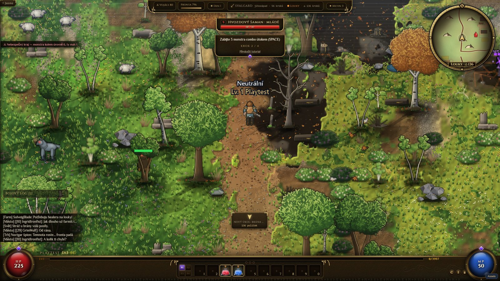
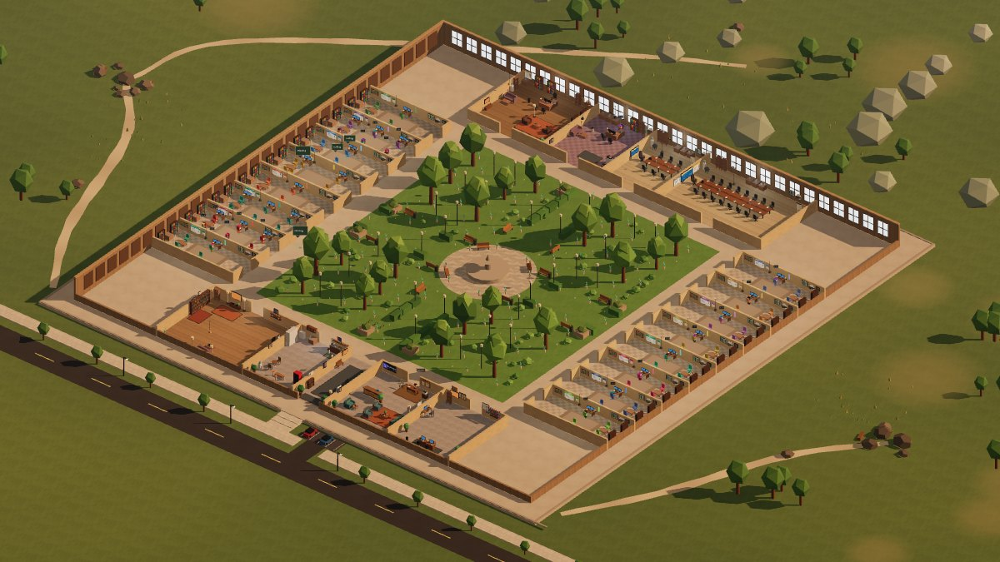
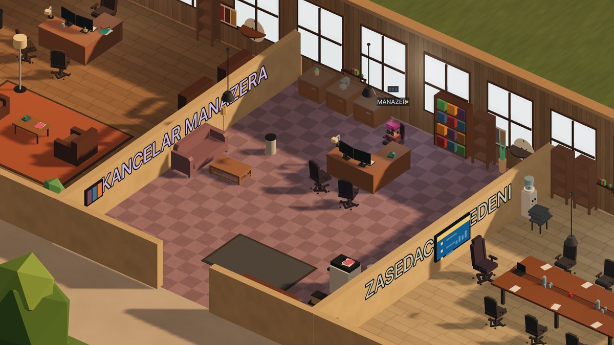
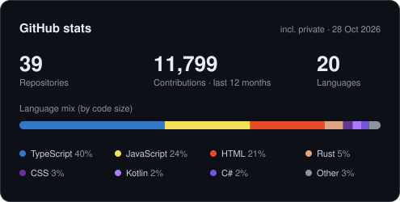
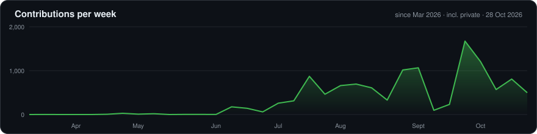

# Jiří Hyan

I build software end to end — usually alone, from the data model to the last pixel.

- **Games** — 2D and 3D with Phaser, Three.js / React Three Fiber, Electron and Tauri
- **AI agents** — tooling built with and for Claude: visual QA, agent orchestration
- **Apps** — React, TypeScript and Firebase, from multi-tenant SaaS to desktop utilities
- **Native mobile** — Kotlin with Jetpack Compose, Swift with SwiftUI, offline-first
- **Back end** — Rust, .NET / C#, Node, Fastify, Postgres

[LinkedIn](https://www.linkedin.com/in/jirihyan/) · Czech Republic

 

## Ashrim

A single-player MMO that behaves like a live server: bot players level up and die around you, and the
war moves on whether you are there or not. Every pixel is drawn by code — no bitmaps, no AI art — and
the world simulation runs in Rust compiled to WebAssembly.

Phaser 3 · TypeScript · Rust / WASM · Tauri 2

 

## WorkSpace

<table>
  <tr>
    <td width="50%"></td>
    <td width="50%"></td>
  </tr>
</table>

A 3D office where every AI coding session is a coworker: a morning stand-up grounded in real git and
test results, tasks from you, finished work walked over for review — and nothing risky runs without
your approval.

Electron · React 19 · Three.js · TypeScript · SQLite · Claude Agent SDK

 

## Ledge

An always-on drawer at the top edge of the Windows screen — projects, dev servers, coding sessions and
notes, one mouse move away. Never steals focus, goes quiet during fullscreen games.

Rust · Tauri 2 · SolidJS · [source](https://github.com/jiri-hyan/ledge-app) · [download](https://github.com/jiri-hyan/ledge-app/releases/latest)

 

## Also built

- **War With Friends** — 3D base-builder with deterministic ballistic missiles · Three.js, Electron
- **Z hadrů na trůn** — medieval idle game, from beggar to king, built for Steam · JavaScript, Electron
- **Bonsai Brew** — cozy bonsai-nursery sim with a procedural pixel-art renderer · C#, Raylib
- **Kronika** — D&D tabletop in Czech with an AI narrator running the rules · React, Fastify, Postgres
- **TeamApp** — multi-tenant platform for sports clubs · Expo, Firebase
- **LayoutLens** — responsive-layout auditor, mobile to 4K, defects out as JSON · Node, Playwright

Most of my repositories are private — happy to walk through the code on a call.

 

<picture>
  <source media="(prefers-color-scheme: dark)" srcset="https://raw.githubusercontent.com/jiri-hyan/jiri-hyan/output/github-contribution-grid-snake-dark.svg">
  
</picture>

